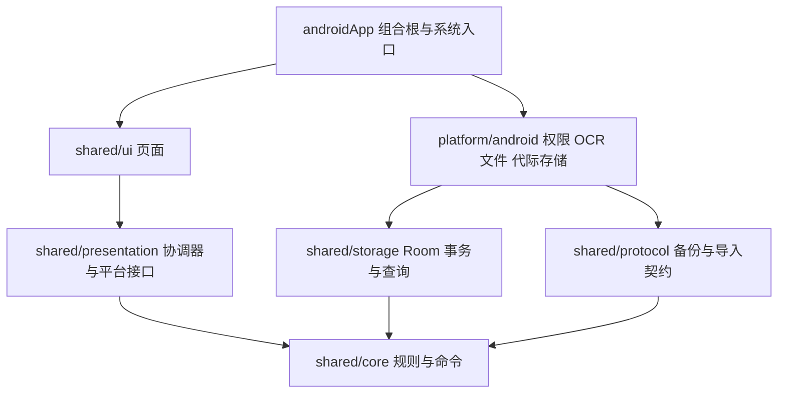

# DawnYew 整体架构审查

> 历史记录：小游戏接入决定已于 2026-10-26 被独立产品方案取代。DawnYew 已移除 2048 运行依赖、保留猜拳；本文当时的代码路径和游戏验收结果不代表当前工程状态。见[拆除记录](2026-10-26-games-detachment.md)。

日期：2026-10-25。基线 HEAD：`c1cd37025e1741369e1de29717c2899ec628ceb9`，审查对象包含当前工作区的 OCR 与全局悬浮改动。由三个视角交叉检查数据层、Android 平台和 UI / 导航，不将测试数量等同于全部业务正确。

## 结论

现有分层可以继续迭代，未发现必须全项目重写才能实现小游戏的阻塞。账务核心、协议和数据库已经与 Android UI 分离；全局截图应留在平台服务，记账原子性与回执仍由共享领域和存储负责。小游戏应使用新的独立模块与私有存档，不能向账务 Command、preferences、备份 schema 增加玩法状态。

这不是“全项目没有问题”的承诺。当前仍有可定位的演进债务，下面明确给出修复触发条件。未重新运行全部历史页面的设备回归，也未执行 OEM 真机兼容矩阵。

## 依赖与责任

当前有明确实现的约束：金额使用整数分；事务内生成操作回执；不确定提交通过 pending marker 恢复；备份先验证候选再发布代际；共享查询检查数据与范围版本；App 锁不会因截图权限而扩大授权；Manifest 去除联网能力。

## 本轮发现并修复

| 问题 | 处置与证据 |
|---|---|
| Activity attach 前读取配置导致启动崩溃 | Controller 配置 lazy；设备启动与开关授权复测通过 |
| 新截图命令回执受 R8 类名修改影响 | 稳定命令名称；Release 构建含 R8 通过 |
| 相同 datasetId 备份恢复后的旧截图写入竞态 | `inGeneration` 将 epoch 检查放进写入/读取/回执 mutex；新增存储测试 |
| 解锁接续丢失默认决策或重复确认 | review 保留默认来源，已确认请求恢复时直接提交 |
| 待处理通知、内存请求与解绑寿命不一致 | 系统 TTL、单请求替换、解绑/息屏/关闭清理，通知失败回收 |
| 排队撤销跨越锁屏或会话变化 | 写入 gate 内再次校验屏幕、会话、代际 |
| 通知发送异常把已写入账单误报失败 | 单独处理通知投递结果，保留已保存事实并提供可见反馈 |

详细实现与实际设备证据见 [全局悬浮验收](2026-10-25-floating-capture-verification.md)。

## 后续债务与优先级

| 优先级 | 事项 | 触发与建议 |
|---|---|---|
| P2 | 整库快照与长期增长的 receipt | 大数据量时先做内存/事务耗时基准，再设计保留幂等契约的归档；不能直接清 receipt |
| P2 | 备份 schema、Room 与领域字段需要手工同步 | 新增持久化字段时以跨层契约测试守护；避免三个地方分别改但缺迁移 |
| P2 | 历史命令的部分回执类型仍依赖 simpleName | 统一前先分析已有回执兼容；新命令用稳定标识，不能直接改旧回执比较语义 |
| P2 | 旧截图待核对通知未与进程内 TTL 同步 | 旧分享/监听链增加系统通知超时与失效反馈；新悬浮通知已经处理 |
| P2 | 部分图片/备份暂存删除未检查返回值 | 在文件所有者边界统一删除失败的可见处理与后续清理，保留当前启动清理保护 |
| P2 | MainActivity 与 DawnYewApp 的编排职责集中 | 沿授权、文件、页面族分别提取；不改变已有导航栈/会话契约，不用大重写替代定位问题 |
| P2 | 中文显示字符串兼任路由 ID | 后续迁移为类型化稳定 ID；小游戏从第一版使用稳定 gameId 与统一宿主路由 |
| P3 | 原生悬浮与 Compose 主题 token 分开 | 后续收敛必要颜色/暗色模式契约，保持服务不依赖财务页面 |

源文件证据、影响分析和审查边界分别保存在：

- [数据、协议与事务](2026-10-25-architecture-review-data.md)
- [Android 平台、权限与生命周期](2026-10-25-architecture-review-platform.md)
- [界面、导航与游戏接入](2026-10-25-architecture-review-ui.md)

## 小游戏平台的实施决定

使用内置插件接口，以模块方式登记和组装；平台负责稳定 ID、独立存档、生命周期和宿主导航，玩法负责规则、状态编码与呈现。当前仅接 2048，不放推箱子/数独空入口。

存档按游戏隔离并限体积，原子写入、串行与版本比较同时约束旧异步任务。损坏或未来版本不自动重置，用户明确重开才覆盖。游戏存档不进入账务备份或清账命令。

沿用现有 Kotlin / Compose 即可完成 2048。Python 或其他运行时以后由需要它的具体插件适配，不预装尚未使用的引擎，不增加联网或动态下载能力。实现计划见 [小游戏计划](../superpowers/plans/2026-10-25-mini-game-platform.md)。
