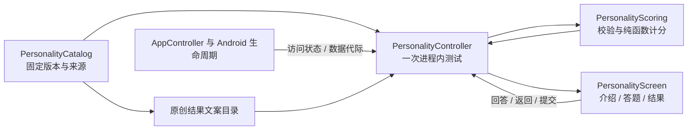

# DawnYew 人格测试工具接入设计

> 本设计的题库、计分和结果方案已由用户指定的 MyMBTI 93 题方案替代，当前不实施此前讨论的 Global 92/143 题版本。以 [93 题实施计划](../plans/2026-10-27-mbti93.md)、[来源契约](../../research/2026-10-27-mymbti93-source.md)和[验证记录](../../implementation/2026-10-27-mbti93-verification.md)为准。以下保留原设计历史。

日期：2026-10-26。代码基线：`e80600e`。目标工作树：`/Users/bytedance/.codex/worktrees/a44d/DawnYew`。

状态：设计评审稿；本轮不修改功能代码，不代表题库已获授权或功能已完成。版本与许可的依据见[题库调研](../../research/2026-10-26-mbti-questionnaire-research.md)。

## 1. 产品决策

在“工具箱”加入人格测试，完成介绍、答题、检查缺答、计分和结果阅读的全离线闭环。无账号、会员、网络请求、AI 服务、额外运行时或新增设备权限。

推荐首版技术候选为 **OEJTS 1.2 的 32 题版**，前提是解决题库及中文译文随本项目分发的许可。该方案采用“十六型人格自测”名称，清楚注明“基于 OEJTS，非官方 MBTI”；不使用“官方 / 标准 MBTI”“认证报告”或“准确率 XX%”。

如果“标准 MBTI”必须指官方量表，改用 **Global Step I 简体中文版授权路线**。它不是对本方案换个题目文件：需要授权的计分合同、报告与相应交互要求，应单独评审。未获授权的官方版本不在 App 里显示空入口。

| 方案 | 与需求的匹配 | 成本与限制 | 本轮决定 |
| --- | --- | --- | --- |
| 官方 Global Step I 中文版 | 满足正式 MBTI 的含义 | 离线题目、计分、报告、源码及 APK 分发均需明确许可 | 正式标准路线，当前不是可直接接入的素材 |
| OEJTS 1.2 / 32 题 | 四对偏好与十六型，自主离线实现可复核 | 非官方；NC/SA 条件与中文内容需要落实 | 有条件的首版技术候选，下面的详细设计基于此 |
| IPIP 大五量表 | 许可更宽松、可离线 | 测量构念与结果不同 | 仅作另一个工具的备选，不静默替换 MBTI |

首版只保留**当前进程内的一次测试**：支持切后台、锁屏、旋转和离开页面后继续；进程被结束后不恢复。暂不做测评历史、云同步、分享海报、多量表商店或题库导入。介绍页用一句话说明“进度仅保留到本次应用进程结束”。不以“自动保存”暗示落盘恢复。

## 2. 现有接入点与改动边界

| 现有位置 | 当前职责 | 本次拟改动 |
| --- | --- | --- |
| `shared/ui/.../MoreScreen.kt` 的 `utilityEntries` / `ToolboxPage` | 工具箱平铺条目 | 增加一个真实可用的条目；沿用 `SettingsSection`、分隔线和 `SettingItem` |
| `shared/ui/.../ProfileScreen.kt` | “我的”也可进入工具箱 | 复用同一个工具入口，覆盖返回行为，不另造一套页面 |
| `shared/ui/.../DawnYewApp.kt` | 字符串路由、返回处理、工具状态容器 | 增加单一路由，挂接专属 controller 和内部返回；不为每一道题增加财务导航栈项 |
| `shared/presentation/.../AppController.kt` | 应用级装配、数据状态与清理 | 装配人格测试 controller，传递访问/数据作用域变化，不内联题目或计分代码 |
| `androidApp/.../MainActivity.kt`、`DawnYewApplication.kt` | 前后台、应用锁、恢复/清空入口 | 复用现有访问条件，区分暂停访问和数据代际清空 |

路径中的 `...` 分别指对应源码根下的 `kotlin/com/dawnyew/ui`、`presentation` 或 `app`。具体文件是现有文件；下一节中 `Personality*` 为拟新增类。

现有 `toolStates = rememberSaveableStateHolder()` 位于 `key(generation, datasetId)` 外层，且按页面名保存。不能直接套用它来保证问卷跨锁定、恢复或清空的语义。本工具答案不放入这个 holder，也不改动其他工具的保留规则。

`UtilityPlatform` 负责尺子/麦克风等硬件能力；人格测试不扩展该接口，不添加 Android 专属计分实现。财务导航、编辑草稿、OCR、其它工具与游戏不在本次重构范围内。

## 3. 模块与数据流

| 层 | 拟新增职责 | 不承担的职责 |
| --- | --- | --- |
| `shared/core/commonMain/.../personality` | 不可变问卷模型、四轴定义、固定目录、答案校验与确定性计分 | 路由、Android 生命周期、存储、授权状态 |
| `shared/presentation/commonMain/.../personality` | `PersonalityController`：当前测试、题号、提交、结果投影、访问暂停和清空 | 猜测题意、网络获取、记账数据写入 |
| `shared/ui/commonMain/.../personality` | 紧凑 Compose 页面、五点选项、答题进度、结果图形与可访问性 | 反向计分、拼接类型、持久化答案 |
| `androidApp` 现有装配 | 传入是否可交互、会话代际和数据代际；保持应用锁保护 | 复制题库、另写一套计分器 |

使用 Kotlin 编译期不可变数据即可，不为 32 题引入通用问卷 DSL、脚本解释器、Python、WebView 或插件平台。来源文件、译文和结果文案独立管理；未来另一套测验只有在确实接入时才增加相应 scorer。

### 数据合同

| 对象 | 必要字段 / 约束 |
| --- | --- |
| `QuestionnaireRevision` | `instrumentId`、`formVersion`、`locale`、`translationVersion`、`scoringVersion`、`contentDigest`；题数不是唯一 ID |
| `SourceMetadata` | 作者、源 URL、源文件 SHA-256、源许可、译文署名与修改说明、分发依据；结果文字的权利单独列出 |
| `BipolarQuestion` | 稳定 `questionId`、原题号、左右描述、对应维度；源题顺序固定，不把反向题左右对调 |
| `Attempt` | 问卷 revision、`Map<QuestionId, Int>`、当前题号、阶段；只有明确作答才有答案，未答不能默认等于 3 |
| `AxisScore` | 维度、原始分、最小/最大/中点、源规则字母、是否恰好中点 |
| `PersonalityResult` | 四轴分数、`sourceType`、允许含未分化轴的 `displayType`、问卷 revision、`resultTextVersion` |
| `TypeDescription` | 类型代码、原创概览、偏好说明、沟通提示、反思问题、内容版本及作者 |

UI 快照不可变，回答动作生成新快照。无效题号、重复题号、越界答案、缺答或 revision 不匹配都必须拒绝计分，并给出可恢复的页面状态。不能用默认空串、0 分或某一类型吞掉错误。

首版只固定一个已经具备分发依据的版本。没有多版本选择器、灰色的“专业版”入口或待实现结果页。目录损坏时展示“测试内容不可用”和返回入口，不输出默认人格。

## 4. 题目、计分与结果

### 4.1 题库制作

候选源文件及公式锁定在[调研第 5 节](../../research/2026-10-26-mbti-questionnaire-research.md#5-oejts-32-题的可复算合同)。正式接入时逐题保留原始编号 Q1–Q32，左右描述各自翻译，不能把双极描述改成所有题统一的“同意程度”。

中文数据发布要求：独立双语审阅、回译检查、试读；特别检查负向含义、情绪词强度、左右倾向和计分方向。记录译文版本，注明 DawnYew 译文及未完成的心理测量验证；不得称为官方中文版。公式完全一致只证明程序复算正确，不证明中文测试具有官方 MBTI 的测量效果。

### 4.2 计分与边界展示

- 全部 32 题作答后才计分，单题范围为整数 1–5。提交时重新验证完整 revision 和答案集合。
- scorer 严格执行源公式与 `> 24` 分类，不为“让结果更好看”调整权重、平局归属或补题。
- `sourceType` 保留原始分类，供内部复算；**用户主要看到的类型按中点轴降级展示**。例如全选 3 时，源规则为 ISFJ，但页面显示“四个维度均未分化”，不显示 ISFJ 性格解读。
- 恰好为 24 的轴记为 `Undifferentiated`；只有四轴均非中点才展示完整四字母类型及相应整段报告。有中点时按轴展示，例如 `I · S · 未分化 · J`，不随意选择相邻类型。
- 首版不创造“接近中点 ±2”“高可信度”“人格稳定性”等阈值，也不提供职业成功、匹配率或诊断结论。
- 图形使用四条双极横轴，每条都有两端名称、中点和当前位置；**不使用雷达图把两端误画成独立能力**，也不展示“外向 80%”之类概率含义不明的数字。

按源公式推导的原始范围为 8–40，中点 24。UI 顺序统一为 E/I、S/N、T/F、J/P；坐标方向必须显式转换，避免源公式 IE / FT 与展示方向相反：

| 横轴左端 → 右端 | 原始分越大越偏向 | 从左到右的位置（0–1） |
| --- | --- | --- |
| E 外向 → I 内向 | E | `(40 - IE) / 32.0` |
| S 实感 → N 直觉 | N | `(SN - 8) / 32.0` |
| T 思考 → F 情感 | T | `(40 - FT) / 32.0` |
| J 判断 → P 感知 | P | `(JP - 8) / 32.0` |

位置仅是分数的线性绘图坐标，不能命名为概率或置信度。读屏读出维度、偏向/未分化和分数位置说明，不依赖颜色区分。

### 4.3 结果内容

结果页展示本次测验与译文版本、四轴解释、类型概览、沟通与自我观察建议；来源页可查看署名与许可。结果文字自主编写，不复制官方报告、16Personalities 的类型外号、插画或网站长文。

完整目录应包含以下 16 个键，每个键满足相同字段合同。下表是**原创内容编写方向**，不是已完成的标准报告或测量结论；正式译题确定后再完成逐项文案审阅。

| 类型键 | 文案重点 |
| --- | --- |
| ISTJ | 独立梳理事实、明确责任和安排，同时观察自己对变化的反应 |
| ISFJ | 留意具体需要和照顾关系，也辨认自己的负担与边界 |
| INFJ | 整理内在想法、重视关系意义，同时核对实际信息 |
| INTJ | 独立形成整体方案，说明推理并给现实反馈留空间 |
| ISTP | 通过实际问题与试验理解事物，也及时说明自己的进展 |
| ISFP | 留意直接体验与个人价值，尝试把偏好和需要表达出来 |
| INFP | 探索意义与可能性，同时把想法转成可执行的小步骤 |
| INTP | 检查概念与逻辑，平衡继续探索与形成行动决定 |
| ESTP | 借助互动与现场信息尝试行动，也留意后续影响 |
| ESFP | 关注当下体验和他人反馈，给较长期的安排留出位置 |
| ENFP | 在互动中发现可能性，练习筛选重点和持续完成 |
| ENTP | 通过讨论探索不同解释，兼顾他人感受和落地条件 |
| ESTJ | 用事实协调任务与安排，主动听取尚未被表达的需要 |
| ESFJ | 关注具体支持与协作秩序，也为不同节奏保留余地 |
| ENFJ | 通过交流凝聚方向，区分他人的需要与自己的责任 |
| ENTJ | 组织目标、推理与行动，检查计划如何影响具体的人 |

文字使用“本次回答呈现的倾向”“可以观察”等表述，不断言“你天生就是”“某类型更优秀”。这是自我了解工具，不是临床诊断或人员筛选报告。

## 5. 页面与交互

### 5.1 入口 / 介绍

“更多 → 工具箱”和“我的 → 工具箱”进入同一条目。图标沿用项目图标体系，不新增整套人物插画。普通二级页沿用紧凑标题、平铺行和分隔线，避免每一段都包成圆角卡片。

介绍区展示名称、32 题 / 五点选择、来源简述、非官方身份、进度保留规则。只有有进程内答题时显示“继续本次测试”和“重新开始”；已经完成时可“查看本次结果”。重新开始有回答或结果时需要确认覆盖，取消则保留原测试。

### 5.2 答题

一页一道题：顶部 `当前题 / 32` 与完成进度，中部两端描述，下方五点选项，底部固定“上一题 / 下一题”。窄屏保证 5 个至少 48dp 的点击区；文字换行而非缩小到难以阅读，放大字体时允许内容滚动，导航按钮仍可触达。

五点从左到右为 1–5，依次表达“完全符合左侧、较接近左侧、两者相当、较接近右侧、完全符合右侧”；端点表示完全符合一侧且不符合另一侧。以上中文锚点与题目一起接受双语复核；屏幕可用点位和两端描述保持紧凑，读屏必须读出完整含义。中间选项没有默认选中。点选只更新当前答案，不立刻跳题，避免选错后追赶页面；上一题及题号目录可回看修改。题号目录标记未答题，不显示任何提前推断的类型。

下一题要求当前题作答；可从题号目录跳题，最后提交若仍有缺答，定位第一道未答题。末题按钮为“查看结果”；无异步服务加载，无人为等待动画。提交执行本地纯函数，连续点击不会产生多个结果页。

系统返回和标题返回行为一致：答题时优先回上一题；第一题返回介绍，进度继续保留。题号目录先关闭；结果页返回介绍。介绍页再返回工具箱。外部导航只认识一个人格测试路由，内部题号不污染财务返回栈。

### 5.3 结果

类型标题或“部分维度未分化”状态 → 四条横轴 → 简短概览 → 可展开的解释与反思建议 → 来源 / 再测一次。四轴不靠动效延迟显示；结果页可以滚动，但首屏呈现最关键结论。

结果页提供“检查/修改答案”，进入题号目录，选题后回到对应答题页。仅查看不影响结果，第一次实际改答立即使旧结果失效，重新完整校验后才能生成新结果。此入口不改变系统返回规则：结果页返回介绍，题号目录返回则关闭目录。

不在答题和结果页加登录、会员、外链测评广告。链接与授权信息作为来源文本展示，答题过程不依赖联网加载。重测清空旧回答；结果页另提供“清除本次结果”，确认后清除答案和结果并返回介绍。取消确认保留当前测试。

## 6. 状态、应用锁与数据清理

### 6.1 所有权

`AppController` 持有专属 `PersonalityController`，与当前 Application 进程同寿命。它私有保存 `Attempt`，只在允许访问时公开 UI 投影。不能始终公开原始答案 `StateFlow` 再仅靠遮罩隐藏。

不把答案或结果放入 `LedgerState.preferences`、Room、文件、`rememberSaveable`、Bundle 或 `SavedStateHandle`。无需修改数据库 schema、备份协议、`LedgerEntityBatch` 或财务校验白名单。问卷回答不触发账本 `contentVersion`、统计刷新或全局 Snackbar。

### 6.2 暂停访问与销毁内容分开

现有 `SessionCoordinator.background()` 在普通后台会撤销会话；即使关闭应用锁，也会改变 session epoch 并调用 `resetTransientState()`。只看 `authorized` 不足以确认可以显示或修改问卷。

本工具定义两个具名动作：

| 动作 | 行为 |
| --- | --- |
| `suspendForAccessChange` | 隐藏 UI 投影、禁用回答/提交、关闭临时浮层、递增交互代际使旧回调失效；保留私有进程内测试 |
| `clearForDataScopeChange` | 先暂停访问，再销毁答案、题号、结果、版本和可继续状态 |

沿用现有财务草稿与导航清理语义，不为了保留问卷放宽记账编辑器规则。重新解锁后仍遵循现有导航回到主页面；用户进入工具箱可继续本次测试，不擅自恢复旧路由。

Android 输入的可交互条件使用现有来源，包含 `resumed && unlocked && !covered && session.authorized && !deviceLocked && repository.state != null`；认证中、外部文件操作、恢复预览及数据替换期间也保持不可交互。前后台、认证结果、锁开关、会话撤销均同步访问状态。文件选择器首次离开可能不撤销会话，所以 `onPause` 也必须暂停访问。旋转只暂停与重开，不销毁 Application 中的测试。`sessionRevocations.collect` 在 Activity 新建时收到当前值，只同步访问状态，不将首次发值当成清空内容的理由。

每个用户动作校验当前交互代际和数据作用域；旧页面、锁定前及旧数据代际的回调一律无效。纯函数计分同步完成，无需启动跨锁定运行的异步评分任务。继续沿用应用现有 `FLAG_SECURE` 与锁定时内容移除策略。

### 6.3 数据作用域

测试绑定 `datasetId + repository.epoch`，不能只绑定数据集 ID：同一备份恢复到原 ID，数据代际仍会变化。

现有 common 层 `LedgerRepository` 不提供 epoch。装配时为本工具注入 `currentDataScope(): PersonalityDataScope?` 读取器，由 Application 中的 repository 引用读取当前 datasetId 与 epoch；数据不可用时返回 null。Controller 不引用 Activity、不强转 Android repository，也不以此前访问事件的快照代替最新代际。Activity 负责同步是否可交互；Controller 每次开放与处理动作时调用读取器校验当前作用域。

| 场景 | 本次测试处理 |
| --- | --- |
| 工具内导航、返回工具箱 | 保留，重新进入可继续 |
| 旋转 / 同进程 Activity 重建 | 保留；访问条件恢复后才展示 |
| 后台 / 熄屏 / 应用锁撤销 | 暂停访问，保留私有进程内内容 |
| 进程被结束或系统回收 | 内容消失，下次进入重新开始；不宣称能恢复草稿 |
| 取消恢复预览、恢复校验失败且 epoch 未变 | 保留 |
| 恢复备份 / 保护副本成功，含同 datasetId | 硬清除 |
| ClearAll、数据失效 / failClosed、数据集改变 | 硬清除 |
| 主动重新开始 / 清除本次结果 | 清除并按用户操作开始或回介绍 |

恢复的发布位于 `NonCancellable` 区域，发布完成后外层调用仍可能返回取消。因此不能只在“恢复调用正常返回”或“成功提示”后清除问卷：在现有恢复与 ClearAll 边界记录 epoch，在 `finally` 中比较，变化就同步硬清除。外部备份和保护副本复用同一恢复入口；每次开放工具与接收动作时也检查当前 epoch。

`AppController` 观察数据不可用或 datasetId 改变时同步清理，但不能只依赖 `StateFlow` 发出的短暂 `null`，因为同 ID 的数据替换可能被合并观察。当前 `repository.epoch` 是现有运行时代际，不需要为此修改备份格式。

将来如果增加“重启后继续 / 历史记录”，需要新的持久化设计，不能悄悄将 JSON 塞进 preferences。至少要明确独立业务数据的所有权、加密、备份/恢复、清空、旧格式兼容和失败原子性。本版不提前创建空数据库表或迁移代码。

## 7. 验证与交付标准

本节是后续开发的验收要求，**不是本轮已执行的测试报告**。

| 层级 | 必须验证 |
| --- | --- |
| 来源与内容 | 固定源文件哈希、许可/译文归属、32 个唯一题号、每轴 8 题、左右描述和计分键对照；16 个原创结果键完整且无重复 |
| 计分单元测试 | 调研中的全 1 / 全 3 / 全 5 向量；各轴最小 8 / 中点 24 / 最大 40；每一题单独增加 1 时对应轴按正负系数变化；其余轴不变 |
| 类型与图形 | 每轴 23 / 24 / 25 的分类；16 个非中点类型可达；中点 UI 不显示确定类型；E/I 与 T/F 图形方向不颠倒 |
| 无效输入 | 缺答、0/6、非法题号、重复题号、问卷 revision 不符；没有猜测补齐或默认结果 |
| Controller | 回答/改答/跳题/返回/重测；改答后结果失效；重复提交幂等；没有账本命令与写盘 |
| 生命周期 | 第 20/32 题切后台后继续；锁开与锁关两条路径；熄屏不展示；旋转不丢；进程重启无旧答案；旧回调不能改写新状态 |
| 数据替换 | 同 ID 恢复、保护副本恢复、ClearAll 均清除；恢复预览取消保留；发布已完成但返回取消仍清除；failClosed 后不能恢复旧测试 |
| UI / 可访问性 | 两处工具箱入口及返回；小屏、大字体、深浅主题；48dp 选项、读屏语义、未答状态、结果滚动；二级页风格一致 |
| 离线与集成 | 飞行模式全流程；不新增网络权限/SDK；不污染账本备份内容；原工具箱、应用锁、恢复和清空相关回归 |

对应实现后执行 `:shared:core:jvmTest`、`:shared:presentation:jvmTest` 和 Android 编译 / lint；设备回归覆盖测试机与可连接实机。构建通过、算法测试通过、交互实机通过和中文内容审定分别记录，不互相代替。

## 8. 后续实施顺序与发布前提

1. 固定产品身份与许可路径：候选 OEJTS 的非官方十六型测试，或官方 Global Step I 授权版。正式资源不能在此之前直接搬进仓库。
2. 对候选完成中文译题、双语对照、原创结果文案及署名；计分合同和测试向量先独立通过，再接 UI。
3. 接入 controller、访问与清理边界，再接工具箱和三个内部页面；保持每步范围可审阅。
4. 独立交叉审查内容/计分和架构/生命周期，处理发现后完成编译与设备验收。

本轮完成的是研究与详细设计。尚未完成的发布前提是：可用于本仓库及 APK 分发的题库权利、审定的中文题目与原创完整结果文案。没有这些依据时不发布“标准 MBTI”，也不提供无法真正完成测试的空入口。

## 9. 本轮交叉审阅与验证记录

三个独立审阅方向分别检查官方资料、开放题库/计分以及项目架构/生命周期。发现与处理如下：

| 编号 | 严重性 | 发现 | 已纳入设计的处理 |
| --- | --- | --- | --- |
| R1 | P2 | “偏左 / 较偏左”没有明确表达五点端点含义 | 第 5.2 节明确完全符合一侧、两者相当及中间档位，并纳入译文复核 |
| R2 | P3 | common 层没有 repository epoch，不能仅要求动作检查而不说明供给方式 | 第 6.3 节明确 Application 装配的当前作用域读取器，不持有 Activity 或使用旧快照 |
| R3 | P3 | 完成后修改答案的入口不明确 | 第 5.3 节增加检查/修改入口，区分只读回看与实际改答后的结果失效 |

R1–R3 的修订均经原审阅方向定向复核通过。官方版本与身份表述未发现有证据的修正项。源 PDF 哈希、四轴公式、全 1/3/5 向量及 8–40 范围已独立核对；开放题库审阅还核对了 16 个非中点类型的可达性。文档本地链接、代码围栏与占位词检查通过。

本轮没有实现题库、执行应用编译或设备回归；第 7 节是后续验收要求。文档审阅不替代授权、中文内容审定或心理测量验证。当前工作树原有的三个本地配置/验证文件未改动。
